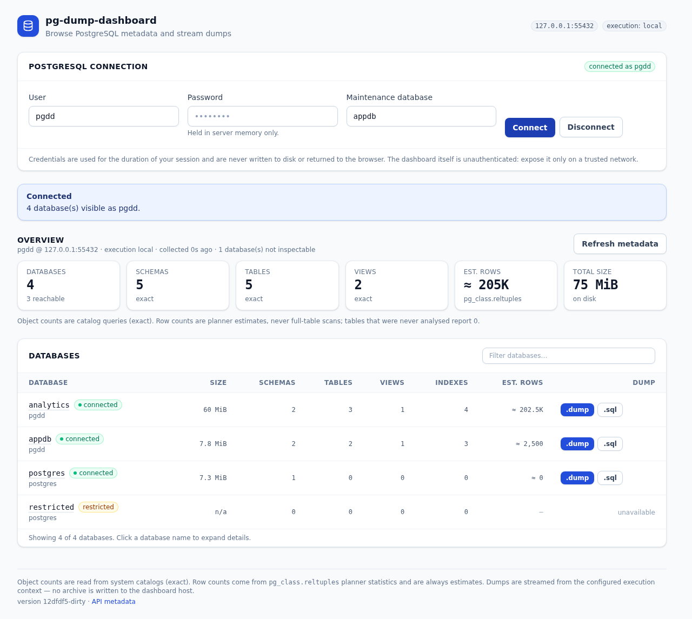
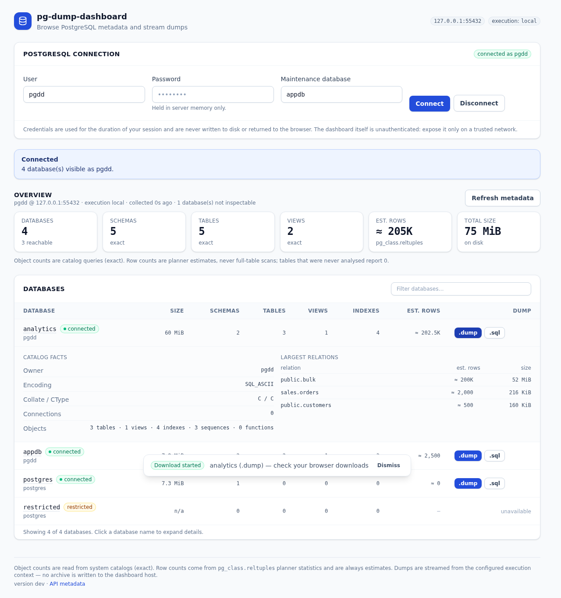

# pg-dump-dashboard

A small, self-contained Go web application for browsing PostgreSQL databases and
streaming `pg_dump` archives to the browser.

The dashboard shows database sizes, schemas, tables, views, indexes and row
estimates for every database the supplied role can see, then lets you download a
dump of any database as a compressed custom archive (`.dump`) or plain SQL
(`.sql`). Dumps are streamed: no archive is ever written to the dashboard host
and nothing is buffered in memory.

The binary embeds its own frontend (Tailwind CSS), so deployment is a single
executable.

---

## Table of contents

- [Features](#features)
- [Architecture](#architecture)
- [Prerequisites](#prerequisites)
- [Build](#build)
- [Running](#running)
- [Configuration reference](#configuration-reference)
- [Execution backends](#execution-backends)
- [HTTP API](#http-api)
- [Metadata: exact vs. estimated](#metadata-exact-vs-estimated)
- [Security](#security)
- [Testing](#testing)
- [Linting](#linting)
- [Releases](#releases)
- [Troubleshooting](#troubleshooting)
- [Limitations](#limitations)
- [License](#license)

---

## Features

- **Credential-driven connection.** The UI asks for a PostgreSQL user, password
  and maintenance database. Credentials live in server memory for the session
  and are never returned to the browser or written to disk.
- **Efficient discovery.** Every dashboard number comes from system catalogs. No
  table is scanned: row counts are planner estimates from `pg_class.reltuples`
  and are labelled as such in the UI and the API.
- **Graceful degradation.** Databases that are unreachable, forbid connections
  (`datallowconn = false`) or are protected by privileges are listed and marked
  instead of failing the whole refresh. Per-database queries run with a
  concurrency limit and their own timeouts.
- **Streamed downloads.** `pg_dump` output is copied straight to the HTTP
  response. If the browser cancels, the process group is killed and reaped.
- **Pluggable execution context.** `psql`/`pg_dump` run either in the
  application's own environment (`local`) or inside an explicitly configured
  Docker container (`docker`). Handlers never branch on the backend.
- **Single binary.** Tailwind CSS is compiled at build time, embedded with
  `go:embed`, and served by the Go server.



Expanding a database shows its catalog facts and largest relations, with row
counts marked as estimates:



## Architecture

```
cmd/pg-dump-dashboard/     entry point: flags → app → signal handling
internal/config/           CLI flags, validation, typed configuration
internal/app/              composition root (backend selection, HTTP server, shutdown)
internal/execution/        Runner/Process interfaces, error types, secret handling
internal/execution/pgclient    argv + environment construction for psql/pg_dump
internal/execution/osprocess   process groups, streaming, bounded stderr capture
internal/execution/local/      local backend
internal/execution/docker/     docker backend (docker exec, config translator)
internal/execution/fake/       scripted runner for tests
internal/postgres/         discovery SQL, parsers, metadata models, error classes
internal/dump/             dump orchestration, streaming, filename sanitisation
internal/httpapi/          JSON API, middleware, static asset handler
internal/session/          in-memory sessions (credentials + cached metadata)
internal/web/              go:embed of the compiled frontend (dist/)
web/                       Tailwind sources and the frontend build script
test/integration/          tests against a real PostgreSQL server
```

Data flow for a download:

```
browser ──GET /api/v1/databases/{db}/dump──▶ httpapi
                                              │
                                              ▼
                                       dump.Service.Stream
                                              │  builds argv + libpq env
                                              ▼
                             execution.Runner (local | docker │ future ssh)
                                              │  stdout pipe
                                              ▼
                                        http.ResponseWriter
```

The HTTP handler knows only about `execution.Runner`. Adding an SSH backend means
implementing `Runner` (and a `Translator`) and selecting it in `internal/app`;
nothing in `postgres`, `dump` or `httpapi` changes.

**No third-party Go dependencies.** The module has an empty `require` list: all
database access goes through the PostgreSQL client tools, so there is no driver
to keep in sync with the server, and the same code path works for `local`,
`docker` and a future `ssh` backend. The only pinned external tool is the
Tailwind CLI, which is used at build time and never shipped.

## Prerequisites

| Purpose | Requirement |
| --- | --- |
| Build the Go binary | Go **1.27** or newer |
| Build the frontend | Node.js 20+ and npm (only for developers; pinned Tailwind CLI 4.3.3) |
| Run without Docker | PostgreSQL client tools `psql` **and** `pg_dump` (13+) on `PATH` of the host |
| Run with Docker | Docker CLI on the host, and a container that contains `psql`/`pg_dump` |
| Database access | A role with `CONNECT` on the target databases (see [privileges](#required-postgresql-privileges)) |

`psql` and `pg_dump` must be available in the **execution context**, which is not
necessarily the machine running the database.

## Build

The frontend must be compiled before the Go binary: `go:embed` requires
`internal/web/dist` to exist.

```bash
# One shot: compile Tailwind, embed it, produce bin/pg-dump-dashboard
make build

# Equivalent manual sequence
cd web && npm ci && npm run build && cd ..   # writes internal/web/dist
go build -trimpath -o bin/pg-dump-dashboard ./cmd/pg-dump-dashboard
```

`internal/web/dist/` only contains a `.gitkeep` placeholder in a fresh checkout.
Building without running the frontend step still compiles, but the server logs a
warning and returns an error for `/`, so always use `make build` (or run
`make frontend` first).

Useful targets:

```bash
make help              # list targets
make deps              # npm ci (frontend dependencies)
make frontend          # Tailwind build + copy assets into internal/web/dist
make build             # frontend + Go build (embedded assets)
make run ARGS="-pg-host db -pg-port 5432"
make test              # unit tests (race detector)
make test-integration  # integration tests against a real server
make lint              # golangci-lint
make check             # fmt + vet + lint + test
make release-check     # goreleaser check
make release-snapshot  # full local release build (no publishing)
```

## Running

```bash
# Local execution backend (psql/pg_dump on this host)
./bin/pg-dump-dashboard \
  -pg-host db.internal \
  -pg-port 5432 \
  -listen 127.0.0.1:8080

# Docker execution backend (psql/pg_dump inside the "pg-primary" container)
./bin/pg-dump-dashboard \
  -pg-host db.internal \
  -pg-port 5432 \
  -execution docker \
  -docker-container pg-primary \
  -listen 127.0.0.1:8080
```

Then open <http://127.0.0.1:8080>, enter the PostgreSQL user, its password and a
maintenance database (for example `postgres` or one of the application
databases), and press **Connect**.

All runtime configuration is discoverable from the CLI:

```bash
./bin/pg-dump-dashboard -h
```

### Configuration reference

| Flag | Default | Purpose |
| --- | --- | --- |
| `-listen` | `127.0.0.1:8080` | HTTP listen address (`host:port`) |
| `-pg-host` | `127.0.0.1` | PostgreSQL server host used for every connection |
| `-pg-port` | `5432` | PostgreSQL server port |
| `-pg-database` | `postgres` | Default maintenance database for discovery |
| `-pg-sslmode` | `prefer` | libpq `sslmode` (`disable`…`verify-full`) |
| `-execution` | `local` | `local` or `docker` |
| `-docker-container` | — | **Required** for `docker`: explicit container name/id |
| `-docker-path` | `docker` | Docker CLI executable |
| `-docker-pg-user` | — | Run client tools as this user inside the container |
| `-psql-path` | `psql` | `psql` name/path inside the execution context |
| `-pg-dump-path` | `pg_dump` | `pg_dump` name/path inside the execution context |
| `-connect-timeout` | `10s` | libpq connection timeout (`PGCONNECT_TIMEOUT`) |
| `-query-timeout` | `15s` | Timeout for one metadata query |
| `-metadata-timeout` | `30s` | Timeout for a complete refresh |
| `-metadata-concurrency` | `4` | Databases inspected in parallel (1–32) |
| `-metadata-max-databases` | `100` | Cap on inspected databases (`0` = no cap) |
| `-dump-timeout` | `0` | Max duration of one download (`0` = unlimited) |
| `-max-concurrent-dumps` | `4` | Simultaneous dump streams (1–64) |
| `-max-request-bytes` | `65536` | Maximum JSON request body |
| `-read-header-timeout` | `10s` | HTTP header timeout |
| `-shutdown-timeout` | `10s` | Graceful shutdown budget |
| `-cookie-secure` | `false` | Mark the session cookie `Secure` (enable behind TLS) |
| `-log-level` | `info` | `debug`, `info`, `warn`, `error` |
| `-log-format` | `text` | `text` or `json` |
| `-version` | — | Print version and exit |

No flag accepts a PostgreSQL password: credentials are entered in the UI and are
kept only in server memory.

## Execution backends

### `local`

The client tools run in the process's own environment. This is the right choice
when the dashboard host can already reach the database with `psql`. `psql` and
`pg_dump` must be installed on that host.

### `docker`

Commands are wrapped as `docker exec …` and executed through the Docker CLI:

```
docker exec --interactive \
  --env PGHOST --env PGPORT --env PGUSER --env PGPASSWORD \
  <container> pg_dump --no-password --format=custom … -- <database>
```

- The container is **never guessed**. `-docker-container` is mandatory; the
  backend refuses to start without it.
- Connection parameters are forwarded as **name-only** `docker exec --env KEY`
  entries, and the values are supplied through the environment of the Docker CLI
  process. A credential therefore never appears in an argument vector
  (`/proc/<pid>/cmdline` is world-readable) — only in the process environment,
  which is restricted to the process owner and root.
- The container must contain `psql` and `pg_dump`; the image used for the
  PostgreSQL server normally does.

### Adding an SSH backend

1. Implement `execution.Runner` (`Run`, `Start`) plus an `execution.Translator`
   that rewrites `psql`/`pg_dump` commands into `ssh <host> …`.
2. Wrap the translated runner the same way `docker.Runner` wraps the local one.
3. Select it in `newRunner` in `internal/app/app.go`.

No handler, discovery query or dump code changes.

## HTTP API

All endpoints are under `/api/v1`. Errors use one envelope:

```json
{ "error": { "code": "auth_failed", "message": "connect to db:5432: psql: error: … password authentication failed" } }
```

| Method | Path | Description |
| --- | --- | --- |
| `GET` | `/api/v1/healthz` | Liveness probe |
| `GET` | `/api/v1/meta` | Version, endpoint, execution context, dump formats |
| `POST` | `/api/v1/connect` | `{"user","password","database"}` → session cookie + overview |
| `GET` | `/api/v1/session` | Current session and cached overview |
| `DELETE` | `/api/v1/session` | Destroy the session and discard credentials |
| `GET` | `/api/v1/overview` | Cached overview |
| `POST` | `/api/v1/overview/refresh` | Re-run discovery with the session credentials |
| `GET` | `/api/v1/databases` | Database list, totals, count sources |
| `GET` | `/api/v1/databases/{name}` | One database plus dump eligibility |
| `GET` | `/api/v1/databases/{name}/dump` | Streamed dump (`?format=custom\|plain`, optional `&schema=`) |

Status codes: `400` invalid input, `401` authentication failed / no session,
`403` database not dumpable, `404` unknown database, `415` wrong content type,
`429` too many concurrent dumps, `502` server unreachable, `503` client tools
missing, `504` timeout, `500` anything else.

The dump endpoint answers with `Content-Disposition: attachment` (safe ASCII
filename with a UTC timestamp), `Content-Type: application/octet-stream` for
custom archives or `application/sql; charset=utf-8` for plain output, and
`Cache-Control: no-store`.

## Metadata: exact vs. estimated

| Value | Source | Accuracy |
| --- | --- | --- |
| Database count | `pg_database` | exact |
| Schema count | `pg_namespace` (excluding `pg_*`, `information_schema`) | exact |
| Tables, views, materialized views, sequences, indexes | `pg_class` grouped by `relkind` | exact |
| Functions | `pg_proc` | exact |
| Database size | `pg_database_size()` | exact at query time |
| Backend connections | `pg_stat_database.numbackends` | exact at query time |
| **Row counts** | `SUM(pg_class.reltuples)` | **estimate** |
| Per-table rows / sizes | `pg_class.reltuples`, `pg_total_relation_size()` | estimate / exact |

`reltuples` is the planner's statistic: it is `-1` for tables that were never
analysed (reported as `0`) and is not updated by every transaction. The API
returns `rowCountSource: "estimate"` and the UI prefixes the numbers with `≈`;
exact object counts are reported with `objectCountSource: "catalog"`. Cheap
exact counts (`count(*)`) intentionally are **not** run, because they require a
full scan on every table.

## Security

### The dashboard itself has no authentication

pg-dump-dashboard authenticates to **PostgreSQL**, not to the operator. There is
no login for the web UI. Anyone who can reach the HTTP endpoint can attempt to
connect to the configured server with credentials of their choosing and download
dumps of any database those credentials can reach.

- Bind to a trusted network interface (`-listen 127.0.0.1:8080` by default).
- For anything else, put the dashboard behind an authenticating reverse proxy
  (mTLS, SSO, basic auth) or a VPN.
- Terminate TLS in front of it and start the binary with `-cookie-secure`.
- PostgreSQL credentials do **not** protect the dashboard; they only limit what
  a visitor can reach inside PostgreSQL.

### Credential handling

- Passwords travel from the browser to the server over the API, are kept in
  process memory for the session lifetime (in-memory store, 30 min idle TTL,
  periodic garbage collection) and are never written to disk.
- The UI clears the password field after connecting and never stores it in
  `localStorage`/`sessionStorage`.
- Responses never include the password: the `execution.Secret` type renders as
  `[redacted]` for every `fmt` verb and for JSON.
- Passwords are passed to `psql`/`pg_dump` through `PGPASSWORD` in the child
  environment, never as a command-line argument (argv is visible in the process
  list). Tool output is scrubbed of sensitive environment values before being
  logged or returned.
- Request logs contain method, path, status, size and duration only.

### Command execution

- No shell is involved anywhere: commands are executed from explicit argument
  vectors (`exec.CommandContext`).
- Database and schema names must match `[A-Za-z0-9_.$-]{1,63}`, may not start
  with `-`, and are additionally separated by `--` where the tool supports it.
- Docker container names are validated before use.
- Attachment filenames are reduced to a conservative ASCII alphabet, so CRLF
  injection and path traversal in `Content-Disposition` are impossible.
- The API cannot run arbitrary commands: the only operations are fixed queries
  and `pg_dump` on a validated database name.

### Docker trust boundary

`-execution docker` requires the Docker CLI and access to the Docker daemon
socket. **Access to the Docker socket is equivalent to root on the Docker
host**: anyone who can call the daemon can start privileged containers and mount
host paths. Enabling this backend therefore extends the dashboard's trust
boundary to the Docker host.

Recommended precautions:

- Run the dashboard as an unprivileged user, ideally in a container of its own.
- If the socket must be mounted, consider a filtering proxy (for example
  tecnativa/docker-socket-proxy) that permits only `exec`-related endpoints.
- Never point `-docker-container` at a container you do not control: the client
  tools inside it are executed with the supplied credentials.
- Keep in mind that the dashboard can reach every database those credentials can
  reach; the container boundary is a deployment detail, not a security
  boundary against PostgreSQL.

### Required PostgreSQL privileges

Discovery:

- `CONNECT` on the maintenance database and on each database you want inspected.
- `pg_database` / `pg_namespace` / `pg_class` / `pg_proc` are readable by
  `PUBLIC`; `pg_stat_database.numbackends` requires `pg_read_all_stats` (or
  superuser) to show other roles' sessions; otherwise only your own are counted.
- `pg_database_size()` requires `CONNECT` (or `pg_read_all_stats` for other
  databases). When it is not allowed the size is reported as `-1` / `n/a`.

Dumps (`pg_dump`):

- `CONNECT` on the database being dumped.
- `SELECT` on every table to dump, `USAGE` on their schemas and `SELECT` on used
  sequences. On PostgreSQL 14+, membership in `pg_read_all_data` grants this in
  one step.
- Large objects and some extensions require additional privileges; `pg_dump`
  reports what it cannot read and the download fails with that message.
- `pg_dump` must be at least as new as the server for full coverage; older
  clients usually work but warn.

Minimal example:

```sql
CREATE ROLE dashboard LOGIN PASSWORD '…';
GRANT pg_read_all_data TO dashboard;   -- PostgreSQL 14+
GRANT pg_read_all_stats TO dashboard;  -- optional: accurate size/connection stats
```

## Testing

```bash
make test        # unit tests with -race (no database required)
make lint
```

Unit tests cover configuration parsing and validation, command construction,
secret redaction, filename sanitisation, discovery parsing and classification,
both execution backends (with a scripted runner, no Docker daemon needed),
dump orchestration and streaming, and the HTTP API.

Integration tests use a real server:

```bash
PGDD_TEST_PG_HOST=127.0.0.1 \
PGDD_TEST_PG_PORT=5432 \
PGDD_TEST_PG_USER=dashboard \
PGDD_TEST_PG_PASSWORD=… \
PGDD_TEST_PG_DATABASE=postgres \
make test-integration
```

They are skipped automatically when `PGDD_TEST_PG_HOST` is unset, and also when
`psql`/`pg_dump` are not on `PATH`.

## Linting

```bash
golangci-lint run ./...     # or: make lint
```

Configuration: [`.golangci.yml`](.golangci.yml), schema `version: 2`, validated
with golangci-lint **v2.15.0** (built with Go 1.27). Enabled besides the standard
set: `bodyclose`, `contextcheck`, `errorlint`, `errname`, `exhaustive`,
`nilerr`, `noctx`, `rowserrcheck`, `sqlclosecheck`, `unconvert`, `unparam`,
`usestdlibvars`, `wastedassign`, `dupword`, `gocritic`, `misspell`, `whitespace`,
`godot`, `gosec`. Exclusions are limited to the `comments`/`std-error-handling`
presets and to non-security linters inside `_test.go` files.

Suppressions in the code base are always annotated with a reason, for example
`//nolint:gosec // Secure is opt-in via -cookie-secure.`

## Releases

[`.goreleaser.yaml`](.goreleaser.yaml) targets GoReleaser v2 (validated with
v2.18.3):

- builds `./cmd/pg-dump-dashboard` for `linux`, `darwin` and `windows` on
  `amd64` and `arm64` with `CGO_ENABLED=0` and `-trimpath`;
- injects `Version`, `Commit` and `Date` into
  `internal/version` through ldflags;
- runs `npm ci` + `npm run build` in `before` hooks and asserts that the frontend
  assets exist, so every archive contains the compiled UI;
- ships `tar.gz` archives (`.zip` on Windows), `checksums.txt` (SHA-256) and
  `README.md`.

Validate and dry-run locally:

```bash
goreleaser check
goreleaser release --snapshot --clean
```

Publish by pushing a tag (`v1.2.3`); GitHub Actions or a local
`goreleaser release` with `GITHUB_TOKEN` creates the release with archives,
checksums and changelog.

## Troubleshooting

| Symptom | Cause and fix |
| --- | --- |
| `PostgreSQL client tools are not available in the configured execution context` | `psql`/`pg_dump` missing on the host or in the container. Install them, or point `-psql-path`/`-pg-dump-path` at the right binaries. |
| `password authentication failed` (401) | Wrong credentials, or the server requires `scram-sha-256` while the client is older. Check `-pg-sslmode` too. |
| `connection refused` / `could not connect` (502) | Wrong host/port, `listen_addresses`, firewall, or `pg_hba.conf`. From inside Docker, `127.0.0.1` is the container, not the host. |
| Every database shows `restricted` | The role lacks `CONNECT`. The dashboard still lists the databases but cannot inspect them. |
| `permission denied for table …` during a dump | The role lacks `SELECT`. Grant `pg_read_all_data` (PG 14+) or the individual tables/sequences. |
| Row counts are `0` or `≈` values look stale | `reltuples` is a planner statistic; run `ANALYZE` or wait for autovacuum. Use exact counts from `psql` if you need them. |
| Dashboard page is blank | Built without the frontend step: run `make frontend` (or `make build`) and check that `internal/web/dist/index.html` exists. |
| `too many concurrent dumps` (429) | More than `-max-concurrent-dumps` downloads are running; retry after one finishes. |
| Dump stops at the same point | The client-side or proxy timeout ended the stream. `-dump-timeout` defaults to unlimited; check reverse-proxy buffering/timeouts. |
| Session expires quickly | Sessions are in memory with a 30-minute idle TTL and are lost on restart. Reconnect. |

## Limitations

- Discovery and dumps run through the PostgreSQL client tools, which must exist
  in the execution context; there is no direct wire-protocol implementation.
- Row counts are estimates by design; exact counts are not offered to avoid full
  table scans.
- Sessions are process-local: no clustering, and a restart requires re-entering
  credentials.
- Only `pg_dump` (single database, optional single schema) is supported; cluster
  dumps (`pg_dumpall`) and restores are out of scope.
- The dashboard has no user accounts or RBAC; PostgreSQL privileges are the only
  authorization mechanism (see [Security](#security)).
- The Docker backend requires Docker CLI access and inherits its trust boundary.

## License

No licence has been specified for this project, so no `LICENSE` file is included
and the default "all rights reserved" applies. Add a licence (for example
`MIT`, `Apache-2.0`) before distributing the binaries, and add `LICENSE` to the
`archives.files` list in `.goreleaser.yaml` at the same time.
